# Lab9Web - Aplikasi PHP Modular

**Praktikum 9 - Pemrograman Web**
Nama : Chelsea Meynita Vadlistya
Program Studi : Teknik Informatika

---

## 1. Tujuan Project

Project ini dibuat untuk mempelajari konsep **modularisasi program PHP**, yaitu memecah aplikasi menjadi beberapa file dan folder agar kode lebih rapi, mudah dibaca, dan mudah dikelola. Tujuan praktikum:

1. Memahami perbedaan `include` dan `require` untuk memanggil file lain.
2. Membuat template halaman (`header.php` dan `footer.php`) yang dipakai berulang.
3. Membuat kumpulan function di satu file (`helpers/functions.php`) dan memanggilnya dari halaman lain.
4. Menyusun struktur direktori aplikasi PHP (`config`, `helpers`, `modules`, `views`, `assets`).
5. Membuat **routing sederhana** melalui satu pintu masuk `index.php?page=...`.
6. Menghubungkan aplikasi ke database MySQL dan membuat **CRUD Data Barang** (tambah, lihat, ubah, hapus, termasuk upload gambar).

---

## 2. Kebutuhan Perangkat

| Kebutuhan | Keterangan |
|-----------|------------|
| XAMPP | Apache, PHP 8.x, dan MySQL/MariaDB (PHP 8 diperlukan karena kode memakai `str_starts_with()` dan operator `??`) |
| Browser | Google Chrome atau browser modern lainnya |
| Code editor | Visual Studio Code |
| phpMyAdmin | Untuk membuat database dan tabel (sudah termasuk di XAMPP) |

---

## 3. Cara Menjalankan Aplikasi

1. Jalankan **XAMPP Control Panel**, lalu start **Apache** dan **MySQL**.
2. Salin folder `Lab9Web` ke dalam `C:\xampp\htdocs\`.
3. Buka **phpMyAdmin** (`http://localhost/phpmyadmin`), lalu buat database bernama **`latihan1`**.
4. Buat tabel **`data_barang`** (contoh struktur sesuai kode program):

   ```sql
   CREATE TABLE data_barang (
       id_barang  INT AUTO_INCREMENT PRIMARY KEY,
       kategori   VARCHAR(100) NOT NULL,
       nama       VARCHAR(150) NOT NULL,
       gambar     VARCHAR(255) DEFAULT NULL,
       harga_beli DOUBLE NOT NULL,
       harga_jual DOUBLE NOT NULL,
       stok       INT NOT NULL
   );
   ```

5. Buat folder **`gambar`** di dalam `Lab9Web` (`C:\xampp\htdocs\Lab9Web\gambar\`). Folder ini dipakai untuk menyimpan gambar barang yang diunggah.
6. Pastikan konfigurasi di `config/database.php` sesuai:

   ```php
   $host = "localhost";
   $user = "root";
   $pass = "";
   $db   = "latihan1";
   ```

7. Buka di browser: **http://localhost/Lab9Web/index.php**

Halaman latihan (di luar aplikasi utama) dapat dibuka langsung, misalnya:

- `http://localhost/Lab9Web/latihan_include/uji-include.php`
- `http://localhost/Lab9Web/latihan_template/home.php`
- `http://localhost/Lab9Web/latihan_function/halaman1.php`

---

## 4. Struktur Direktori

```
Lab9Web/
├── index.php                 # Front controller: routing + pemanggilan template
├── assets/
│   └── css/
│       ├── style.css         # Tampilan aplikasi
│       └── script.js
├── config/
│   └── database.php          # Koneksi MySQL (mysqli)
├── helpers/
│   └── functions.php         # Kumpulan function (formatRupiah, e(), dll.)
├── views/
│   ├── header.php            # Template bagian atas + menu navigasi
│   ├── footer.php            # Template bagian bawah
│   ├── dashboard.php         # Halaman Dashboard
│   └── 404.php               # Halaman jika rute tidak ditemukan
├── modules/
│   ├── barang/               # CRUD Data Barang (terhubung database)
│   │   ├── list.php
│   │   ├── add.php
│   │   ├── edit.php
│   │   └── delete.php
│   ├── user/                 # Modul Pengguna (tampilan)
│   │   ├── list.php
│   │   ├── add.php
│   │   ├── edit.php
│   │   └── delete.php
│   └── auth/
│       ├── login.php
│       └── logout.php
├── gambar/                   # Tempat gambar barang yang diunggah (dibuat manual)
├── latihan_include/          # Latihan include dan require
│   ├── pesan.php
│   ├── uji-include.php
│   └── uji-require.php
├── latihan_template/         # Latihan template header/footer
│   ├── header.php
│   ├── footer.php
│   ├── style.css
│   ├── home.php
│   ├── about.php
│   └── kontak.php
├── latihan_function/         # Latihan function
│   ├── halaman1.php
│   └── halaman2.php
└── screenshots/              # Screenshot hasil praktikum untuk README
```

---

## 5. Daftar Rute

Semua halaman aplikasi diakses lewat `index.php` dengan parameter `page`. Rute didaftarkan pada array `$routes` di `index.php` (whitelist), sehingga hanya halaman yang terdaftar yang dapat dibuka. Rute di luar daftar akan menampilkan `views/404.php` dengan status HTTP 404. Jika parameter `page` kosong, halaman yang dibuka adalah `dashboard`.

| Rute (`?page=`) | File | Keterangan |
|-----------------|------|------------|
| *(kosong)* / `dashboard` | `views/dashboard.php` | Halaman utama |
| `user/list` | `modules/user/list.php` | Daftar pengguna |
| `user/add` | `modules/user/add.php` | Form tambah pengguna |
| `user/edit` | `modules/user/edit.php` | Form ubah pengguna |
| `user/delete` | `modules/user/delete.php` | Halaman hapus pengguna |
| `auth/login` | `modules/auth/login.php` | Form login |
| `auth/logout` | `modules/auth/logout.php` | Logout |
| `barang/list` | `modules/barang/list.php` | Daftar barang dari database |
| `barang/add` | `modules/barang/add.php` | Tambah barang (+ upload gambar) |
| `barang/edit&id=N` | `modules/barang/edit.php` | Ubah barang berdasarkan `id_barang` |
| `barang/delete` | `modules/barang/delete.php` | Hapus barang (hanya menerima metode POST) |

Contoh: `http://localhost/Lab9Web/index.php?page=barang/list`

---

## 6. Langkah Praktikum

### Langkah 1 - Latihan `include` dan `require`

File `pesan.php` berisi satu baris `echo`. File `uji-include.php` dan `uji-require.php` memanggil `pesan.php` dengan `__DIR__` agar path selalu benar.

```php
echo "Sebelum pemanggilan<br>";
include __DIR__ . '/pesan.php';
echo "<br>Sesudah pemanggilan";
```

Perbedaannya: jika file tidak ditemukan, `include` hanya memberi *warning* dan program tetap berjalan, sedangkan `require` menghentikan program (*fatal error*). Karena itu `require` dipakai untuk file yang wajib ada (misalnya `functions.php` dan `database.php`).

Hasil `uji-include.php`:

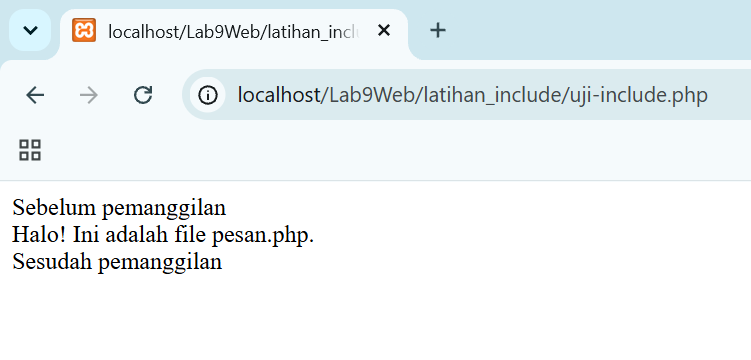

### Langkah 2 - Template Header dan Footer

Bagian halaman yang sama (kepala, menu, dan footer) dipisah ke `header.php` dan `footer.php`. Setiap halaman cukup memanggilnya dengan `require_once`:

```php
<?php require_once __DIR__ . '/header.php'; ?>

<section class="content">
    <h2>Halaman Home</h2>
    ...
</section>

<?php require_once __DIR__ . '/footer.php'; ?>
```

Hasil halaman **Home**:

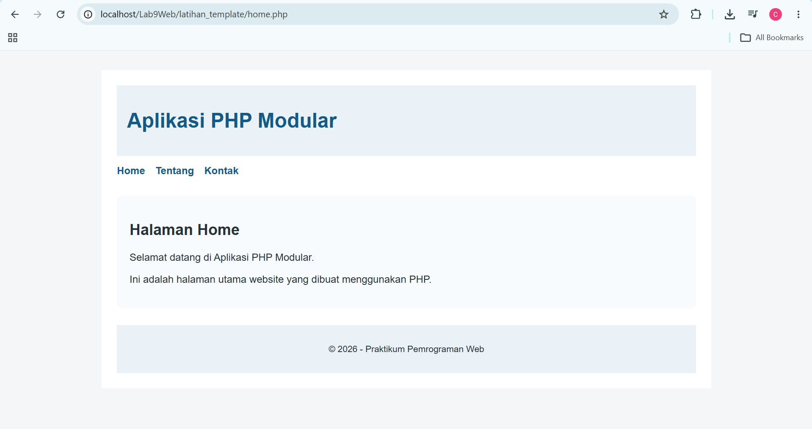

Hasil halaman **Tentang**:

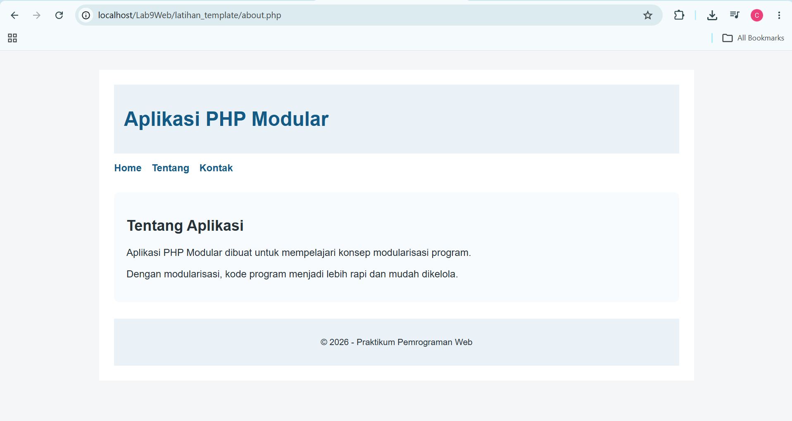

Hasil halaman **Kontak**:

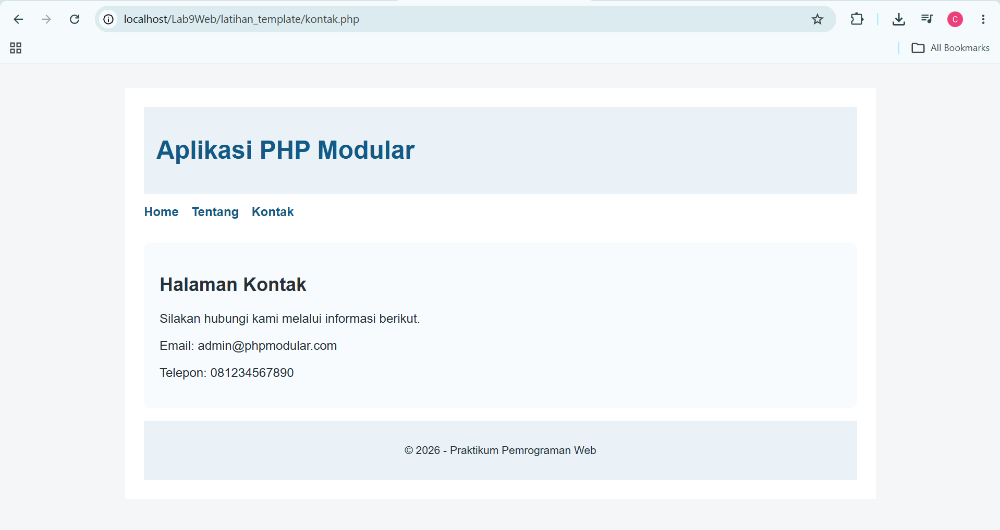

### Langkah 3 - Latihan Function

Semua function dikumpulkan di `helpers/functions.php`:

| No | Function | Fungsi |
|----|----------|--------|
| 1 | `tampilkanSalam()` | Function tanpa parameter |
| 2 | `sapaPengguna($nama)` | Function dengan parameter (output diamankan `htmlspecialchars`) |
| 3 | `hitungLuasPersegiPanjang($panjang, $lebar)` | Function dengan return |
| 4 | `hitungDiskon($harga, $persen = 10)` | Parameter default |
| 5 | `formatRupiah($angka)` | Format angka menjadi `Rp 500.000` |
| 6 | `validasiEmail($email)` | Validasi email dengan `filter_var` |
| 7 | `ringkasTeks($teks, $maksimal = 30)` | Memotong teks panjang |
| 8 | `konversiCelciusKeFahrenheit($c)` | Konversi suhu |
| 9 | `tentukanStatusNilai($nilai)` | Menentukan predikat A/B/C/D |
| 10 | `hitungTotal($harga, $jumlah)` | Menghitung total belanja |
| 11 | `e($nilai)` | Singkatan `htmlspecialchars` untuk keamanan output |

Kode `functions.php`:

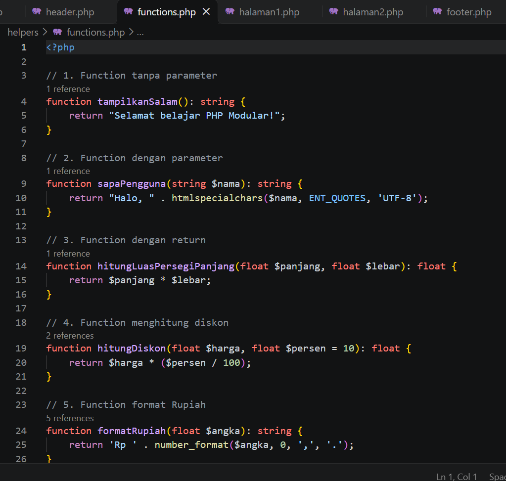

Kode `halaman1.php` dan `halaman2.php` yang memanggil function tersebut:

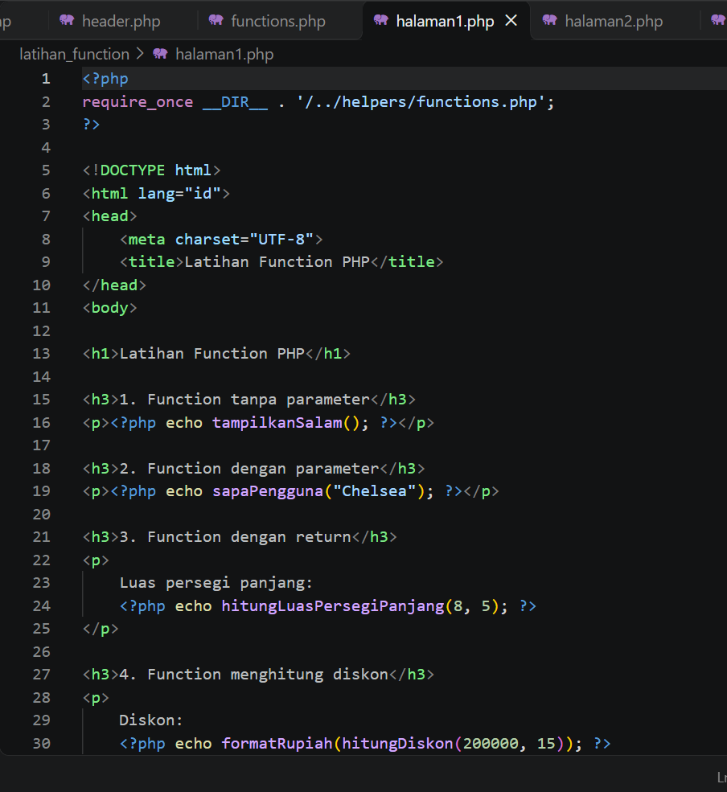

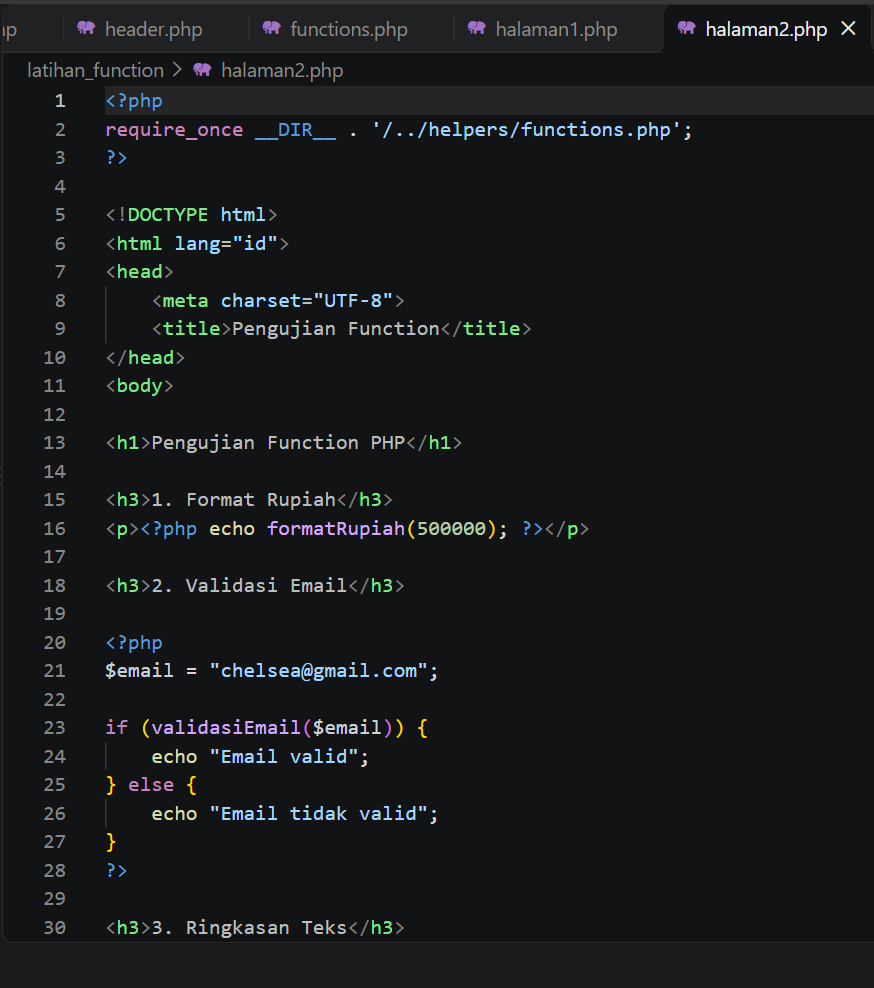

Hasil `halaman1.php`:

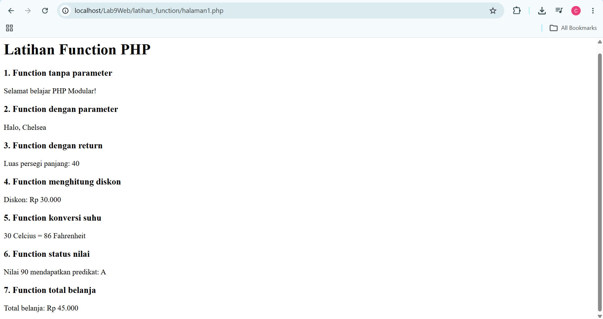

Hasil `halaman2.php`:

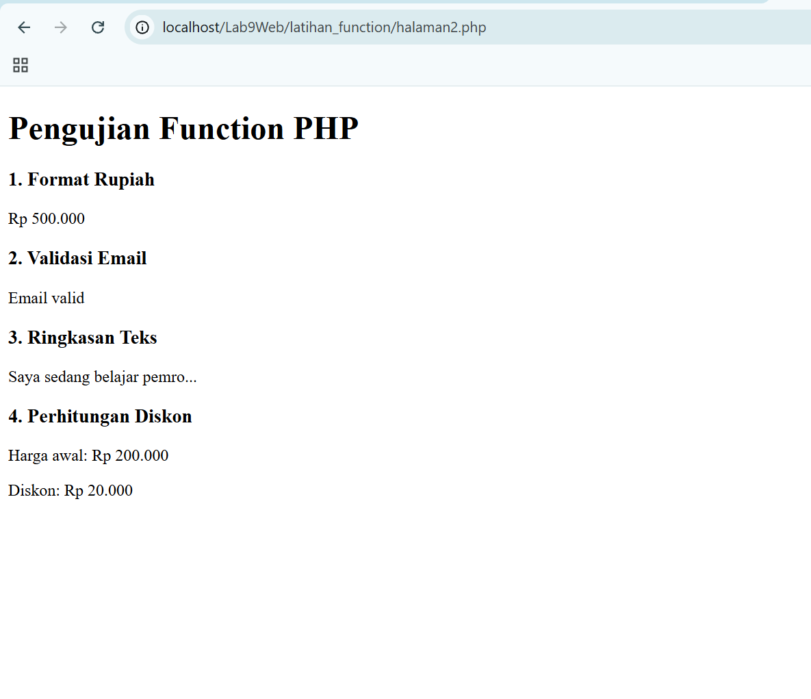

### Langkah 4 - Struktur Direktori dan Routing

Aplikasi disusun ulang menjadi struktur modular (lihat bagian 4). Semua permintaan masuk lewat `index.php`, yang melakukan hal berikut:

1. Memanggil `helpers/functions.php` dan `config/database.php`.
2. Membaca parameter `page` dari URL (`$_GET['page'] ?? 'dashboard'`).
3. Mencocokkan dengan daftar rute `$routes`. Jika tidak ada, memakai `views/404.php`.
4. Menampilkan `views/header.php`, lalu isi halaman, lalu `views/footer.php`.

Hasil rute **Dashboard** (`index.php`):

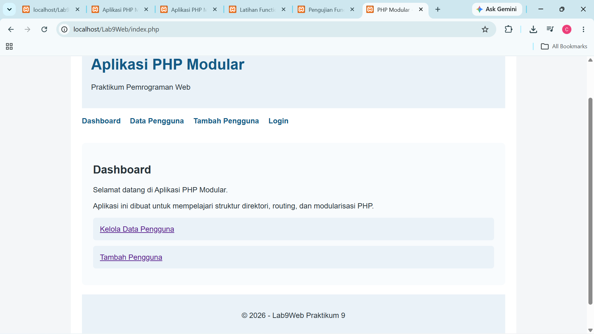

Hasil rute **Data Pengguna** (`?page=user/list`):

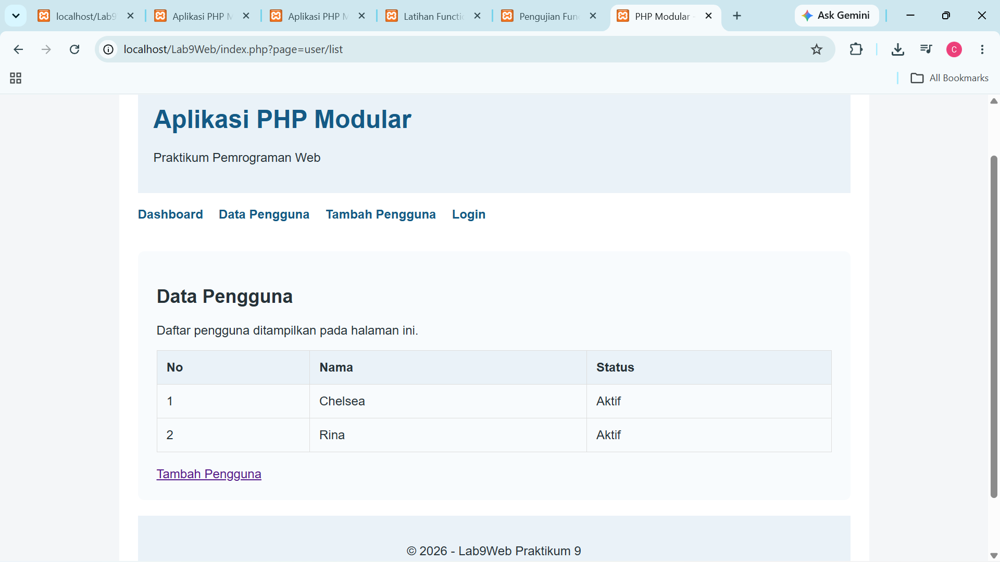

Hasil rute **Login** (`?page=auth/login`):

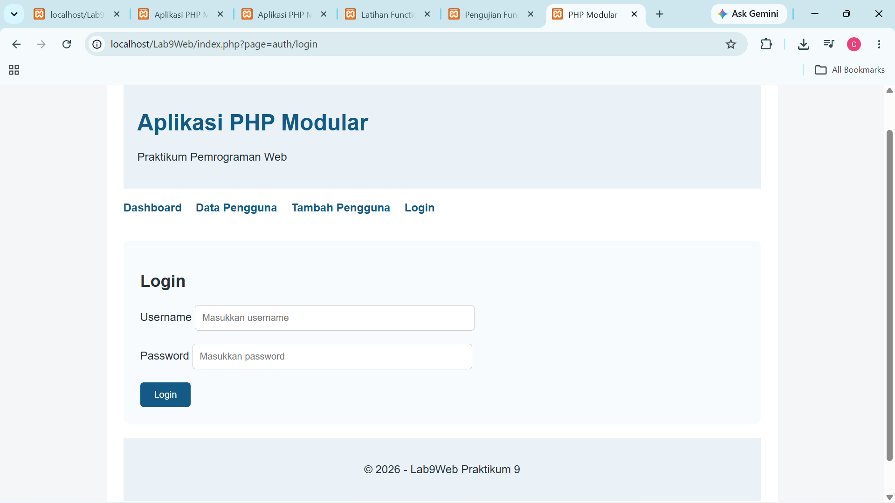

### Langkah 5 - CRUD Data Barang (MySQL)

Koneksi database dibuat di `config/database.php` memakai `mysqli_connect` ke database `latihan1`. Seluruh query memakai **prepared statement** (`mysqli_prepare`, `mysqli_stmt_bind_param`) agar aman dari SQL injection.

**a. Tampilan awal data barang dari database.** Tahap pertama, data dari tabel `data_barang` ditampilkan apa adanya.

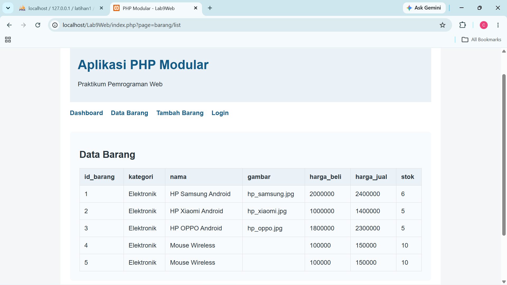

**b. Tambah barang** (`?page=barang/add`). Form berisi nama, kategori, harga beli, harga jual, stok, dan gambar. Upload gambar dibatasi ekstensi JPG/JPEG/PNG/WEBP dan maksimal 2 MB, lalu disimpan dengan nama unik di folder `gambar/`.

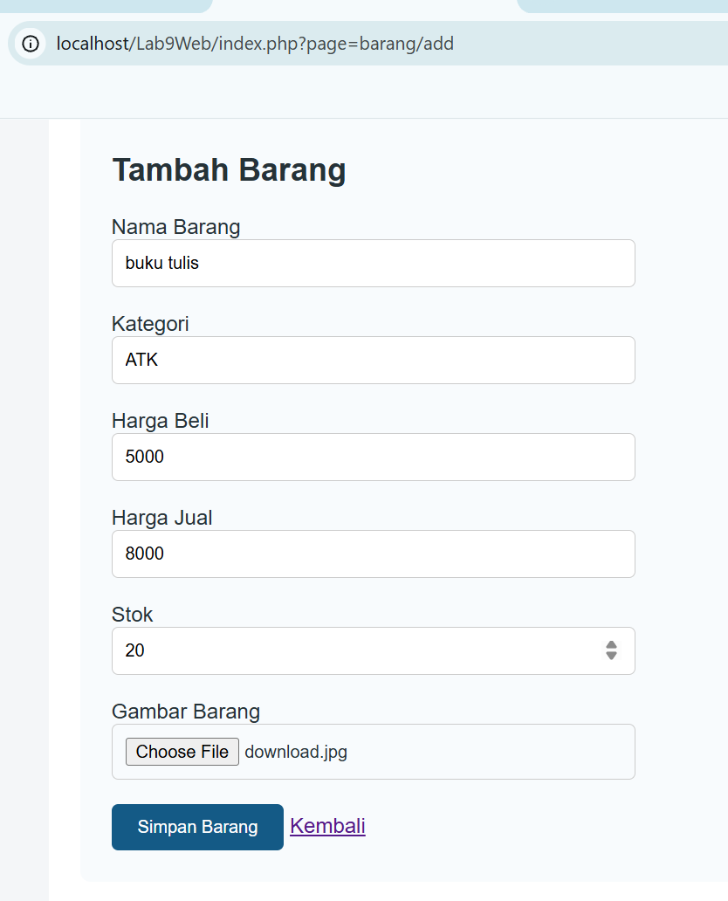

Data yang baru disimpan muncul pada tabel:

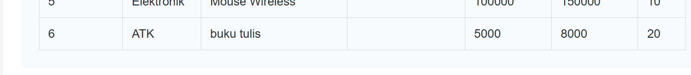

**c. Lihat data barang** (`?page=barang/list`). Tampilan tabel disempurnakan: ada nomor urut, harga diformat Rupiah, dan kolom Aksi berisi tombol Edit dan Hapus.

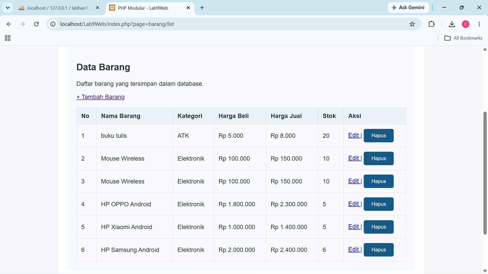

**d. Ubah barang** (`?page=barang/edit&id=N`). Form terisi data lama; gambar hanya diganti jika ada file baru. Contoh: stok barang "buku tulis" diubah menjadi 30.

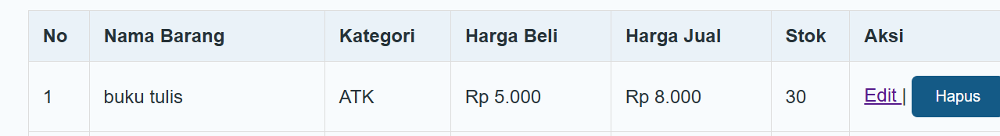

Kemudian diubah kembali menjadi 20:

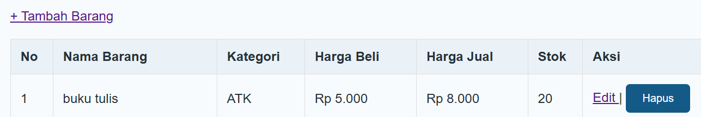

**e. Hapus barang** (`?page=barang/delete`). Penghapusan hanya menerima metode **POST** dan didahului konfirmasi JavaScript. Jika barang memiliki gambar, file gambarnya ikut dihapus dari folder `gambar/`.

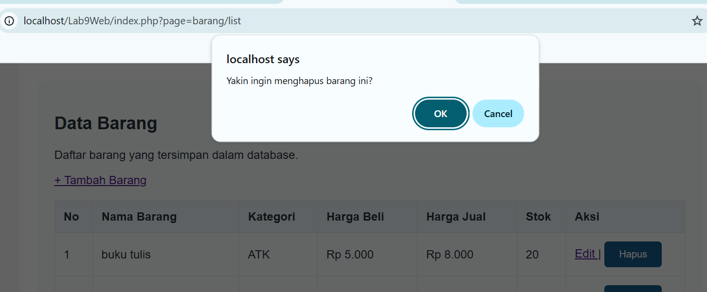

### Langkah 6 - Modul Pengguna dan Login

Modul `user` dan `auth` dibuat sebagai kerangka halaman (form tambah/ubah pengguna dan form login) untuk melatih struktur modul dan routing. Tampilannya dapat dilihat pada screenshot rute di Langkah 4.

---

## 7. Catatan Keamanan

- **Whitelist routing**: hanya rute di array `$routes` yang bisa diakses, sehingga tidak ada *file inclusion* dari input pengguna.
- **Prepared statement** pada semua query CRUD barang.
- **Escape output** dengan `htmlspecialchars()` / `e()` untuk mencegah XSS.
- **Validasi upload**: ekstensi, ukuran maksimal 2 MB, dan `is_uploaded_file()`; nama file diganti dengan `uniqid()`.
- **Hapus via POST**, bukan lewat link, agar tidak terhapus tanpa sengaja.

## 8. Batasan Saat Ini

- Data pada halaman `user/list` masih statis (belum dari database) dan form tambah/ubah pengguna belum menyimpan data.
- Form login belum memproses autentikasi, dan `auth/logout.php` masih kosong.
- Folder `gambar/` harus dibuat manual sebelum fitur upload dipakai.
